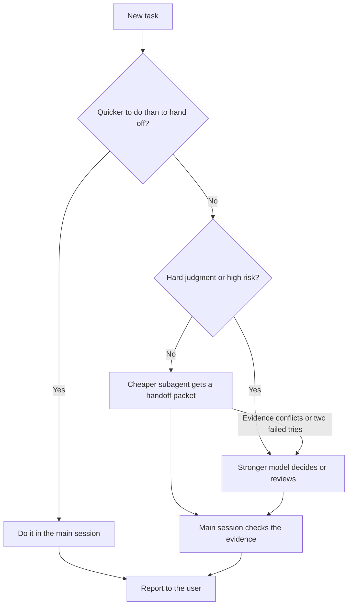

# Efficient Frontier Routing

[](../../../../LICENSE) [](CHANGELOG.md)

[](../../../../README.md#compatibility) [](../../../../README.md#compatibility) [](../../../../README.md#compatibility)
> The Claude app and ChatGPT have no documented subagents, so it only reports that it cannot route. Other agents: routes in Gemini CLI, Antigravity CLI, Cursor and OpenCode; not verified in GitHub Copilot, Windsurf or Cline.

Routes each task to a suitable model tier in Claude Code, Codex, or another agent host that can start subagents on a chosen model (Gemini CLI, for example), following the user's routing preferences. Keeps small tasks local, delegates discovery, routine coding, and testing to cheaper subagents, and sends difficult decisions and risky reviews to a stronger one. Use when deciding whether to delegate, writing subagent handoffs, or setting routing preferences, or when asked to "save tokens", "use cheaper models", "fan out subagents", "stay inside my quota", or "efficient-frontier-routing help".

## When and how to use it

**Use it when**
- A task mixes search, edits and test runs, and you want cheaper models for the routine parts.
- A change touches billing or auth and you want a stronger model to review it.
- You want to write a clear handoff for a subagent.

**Try it**

```text
Fix the failing checkout tests. Use cheaper agents to search and run tests. Use a stronger one to review the refund change.
/efficient-frontier-routing help
```

The work is split by model tier. The agent reviews what the subagents return and reports which model ran each step. The help command explains the settings and then stops. Other agents can ask in words.

**Skip it when**
- The task is small, such as a one-file edit. Doing it in the main session costs less than a handoff.

## What it looks like

How one task gets routed with the default settings:



High risk means auth, billing, permissions, security, migrations, data loss, shared state, caching, concurrency, cross-module behavior, public APIs, or user-visible workflows. Your own routing preferences (which models, how many subagents, whether escalation needs approval) override these defaults.

## Install

<!-- install:begin -->
Pick your platform. Steps expand below. The [Install section of the collection README](../../../../README.md#install) has the full guide.

<details>
<summary><b>Claude Code (terminal CLI)</b> — recommended</summary>

```bash
claude plugin marketplace add evemcgivern/agent-skills
claude plugin install agent-workflow@evemcgivern-skills
```

This installs the whole `agent-workflow` plugin, so you also get its other skills: `agent-doctor`, `ambition`, `check-worth`, `fable-chief-agent`, `goal-checklist`, `handoff`, `mission`, `problem-first`, `quick-recap`, `sonnet-prompt-improver`, `stay-within-limits`, `up-to-speed`. Run it as `/agent-workflow:efficient-frontier-routing`. Inside a session, the same thing is `/plugin marketplace add evemcgivern/agent-skills`, then `/plugin install agent-workflow@evemcgivern-skills`.

Update later with `claude plugin marketplace update evemcgivern-skills`, then `claude plugin update agent-workflow@evemcgivern-skills`.

To install only this skill, copy it from a clone of the repo:

```bash
git clone https://github.com/evemcgivern/agent-skills.git && cd agent-skills
scripts/install.sh efficient-frontier-routing   # into ~/.claude/skills/efficient-frontier-routing
```

Add `--project <repo-path>` for one repository only, or `--force` to replace a copy you already have.

</details>

<details>
<summary><b>Claude Code desktop app</b></summary>

In a local Code session choose **+ → Plugins → Add plugin**, enter `evemcgivern/agent-skills` as the marketplace, then install **agent-workflow** (it brings the plugin's other skills too).

Local desktop and CLI sessions share user-scope installs. Cloud Code sessions do not load local plugins; commit this skill folder to your repository's `.claude/skills/efficient-frontier-routing/` instead.

</details>

<details>
<summary><b>Codex (CLI, IDE extension, desktop app)</b></summary>

```bash
git clone https://github.com/evemcgivern/agent-skills.git && cd agent-skills
scripts/install.sh --target codex efficient-frontier-routing   # into ~/.agents/skills/efficient-frontier-routing
```

Add `--project <repo-path>` to install into that repository's `.agents/skills/efficient-frontier-routing/` instead. Or copy this folder by hand to `~/.agents/skills/efficient-frontier-routing/`, or `.agents/skills/efficient-frontier-routing/` in a repository; keep every file in it together. Start a new session and invoke the skill by name. See the [Codex skills docs](https://developers.openai.com/codex/skills-and-plugins).

</details>

<details>
<summary><b>Other agents: Gemini CLI, Antigravity CLI, Cursor, GitHub Copilot, Windsurf, OpenCode, Cline</b> — works with a limit</summary>

These agents load `SKILL.md` folders directly. Copy this whole folder to the place your agent reads:

- Gemini CLI, Antigravity CLI, Cursor, GitHub Copilot, OpenCode: `~/.agents/skills/efficient-frontier-routing/` for personal use (`scripts/install.sh --target codex efficient-frontier-routing` does this), or `<repo>/.agents/skills/efficient-frontier-routing/` for one repository.
- Windsurf: `<repo>/.agents/skills/efficient-frontier-routing/`.
- Cline: `<repo>/.cline/skills/efficient-frontier-routing/`, `<repo>/.claude/skills/efficient-frontier-routing/` or `~/.cline/skills/efficient-frontier-routing/`.

**Limit:** Routes only where the agent starts subagents on a chosen model: Gemini CLI, Antigravity CLI, Cursor and OpenCode document this; GitHub Copilot, Windsurf and Cline are not verified.

</details>

<details>
<summary><b>Claude app: not supported</b></summary>

The Claude app has no documented subagents, so the skill can only report that it cannot route.

Use Claude Code or Codex on your computer instead.

</details>

<details>
<summary><b>ChatGPT: not supported</b></summary>

ChatGPT has no documented subagents, so the skill can only report that it cannot route.

Use Claude Code or Codex on your computer instead.

</details>

Routing needs a host that lets you pick the model for each subagent. Claude Code, Codex, Gemini CLI, Antigravity CLI, Cursor and OpenCode document this. The Claude app and ChatGPT have no documented subagents, and GitHub Copilot, Windsurf and Cline are not verified; there the skill reports that it cannot route instead of routing.

<!-- install:end -->

## Contents

- `SKILL.md` — skill instructions and metadata.
- `references/configuration.md` — help text: saving the main model, effort, and routing preferences in Claude Code and Codex, a reusable review agent, and troubleshooting.
- `VERSION` and `CHANGELOG.md` — package version history.
