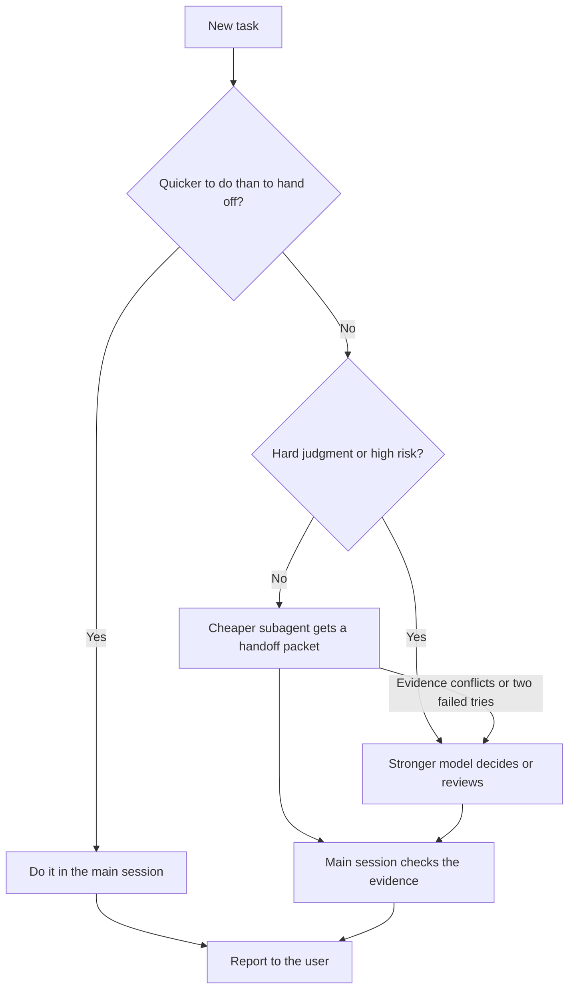

# Efficient Frontier Routing

 

  
> The Claude app and ChatGPT have no documented subagents, so it only reports that it cannot route. Other agents: routes in Gemini CLI, Antigravity CLI, Cursor and OpenCode; not verified in GitHub Copilot, Windsurf or Cline.

Routes each task to a suitable model tier in Claude Code, Codex, or another agent host that can start subagents on a chosen model (Gemini CLI, for example), following the user's routing preferences. Keeps small tasks local, delegates discovery, routine coding, and testing to cheaper subagents, and sends difficult decisions and risky reviews to a stronger one. Use when deciding whether to delegate, writing subagent handoffs, or setting routing preferences, or when asked to "save tokens", "use cheaper models", "fan out subagents", "stay inside my quota", or "efficient-frontier-routing help".

## What it looks like

How one task gets routed with the default settings:

High risk means auth, billing, permissions, security, migrations, data loss, shared state, caching, concurrency, cross-module behavior, public APIs, or user-visible workflows. Your own routing preferences (which models, how many subagents, whether escalation needs approval) override these defaults.

## Install

See [Install](../../../../README.md#install) in the collection README. Copy this complete folder as `efficient-frontier-routing/`; keep every file in it together.

Routing needs a host that lets you pick the model for each subagent. Claude Code, Codex, Gemini CLI, Antigravity CLI, Cursor and OpenCode document this. The Claude app and ChatGPT have no documented subagents, and GitHub Copilot, Windsurf and Cline are not verified; there the skill reports that it cannot route instead of routing.

## Contents

- `SKILL.md` — skill instructions and metadata.
- `references/configuration.md` — help text: saving the main model, effort, and routing preferences in Claude Code and Codex, a reusable review agent, and troubleshooting.
- `VERSION` and `CHANGELOG.md` — package version history.
