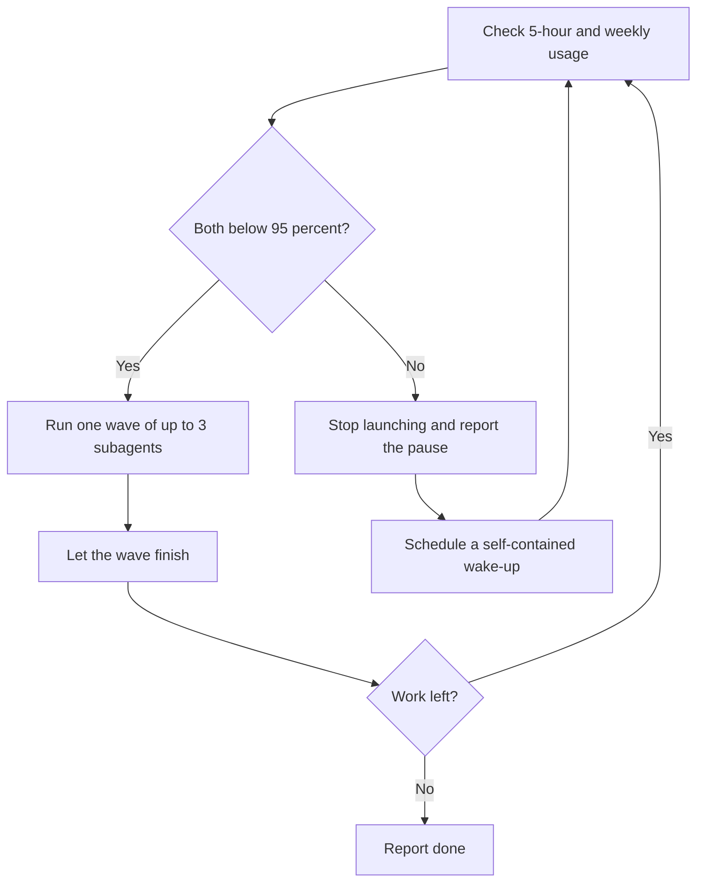

# Stay Within Limits

[](../../../../LICENSE) [](CHANGELOG.md)

[](../../../../README.md#compatibility) [](../../../../README.md#compatibility) [](../../../../README.md#compatibility)
> The Claude app and ChatGPT cannot run it. Codex and other agents: the usage checks read Claude Code only, so you supply the usage numbers, and no scheduled wake-up is documented.

Keeps long-running or parallel agent work inside 5-hour and weekly usage limits by running work in bounded waves, checking usage between waves, pausing at 95%, and resuming only after the window resets. Use for multi-wave subagent runs, overnight or unattended jobs, or when asked to "don't blow my usage", "watch my limits", "pause before the cap", or "resume when the window resets".

## What it looks like

The loop, with the defaults (95% threshold, at most 3 subagents per wave):



A wake-up re-checks real usage; time passing is not proof the window reset. A pause report names the window, the usage seen, the next check, and the work left. Example, invented data:

```text
Paused: weekly window at 96% (5-hour window at 41%). Next check at 14:00,
then hourly until it drops below 95%. Remaining: waves 3 and 4, six subagents.
```

## Install

Copy this complete folder to `~/.claude/skills/stay-within-limits/` for Claude Code (CLI and local desktop sessions), or to `~/.agents/skills/stay-within-limits/` for Codex, Gemini CLI, Antigravity CLI, Cursor, GitHub Copilot and OpenCode. For one repository only, copy it to `.claude/skills/stay-within-limits/` or `.agents/skills/stay-within-limits/` (Windsurf also reads `.agents/skills`); Cline reads `.cline/skills/stay-within-limits/` or `.claude/skills/stay-within-limits/`. The usage checks (`ccusage` and `/usage`) read Claude Code only: in Codex and other agents it still runs work in waves, but you supply the usage numbers and no automatic wake-up is documented for those agents. Supporting files in this folder may be required. See the [collection README](../../../../README.md) for current platform notes.

## Contents

- `SKILL.md` — skill instructions and metadata.
- `VERSION` and `CHANGELOG.md` — package version history.
