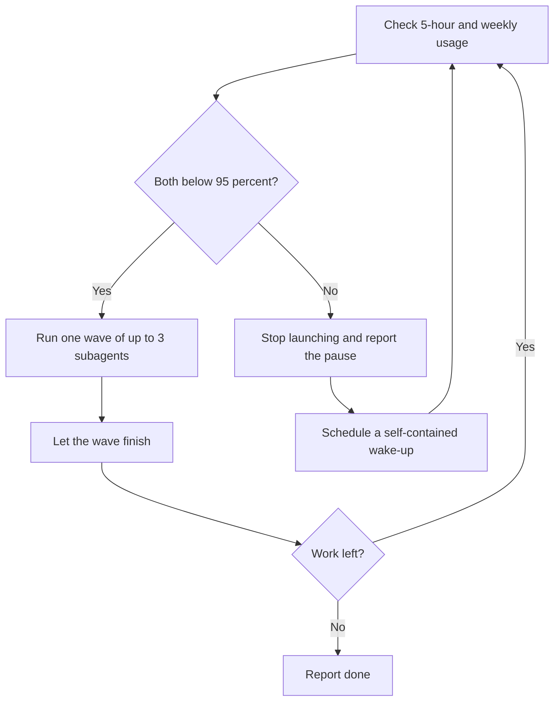

# Stay Within Limits

[](../../../../LICENSE) [](CHANGELOG.md)

[](../../../../README.md#compatibility) [](../../../../README.md#compatibility) [](../../../../README.md#compatibility)
> The Claude app and ChatGPT cannot run it. Codex and other agents: the usage checks read Claude Code only, so you supply the usage numbers, and no scheduled wake-up is documented.

Keeps long-running or parallel agent work inside 5-hour and weekly usage limits by running work in bounded waves, checking usage between waves, pausing at 95%, and resuming only after the window resets. Use for multi-wave subagent runs, overnight or unattended jobs, or when asked to "don't blow my usage", "watch my limits", "pause before the cap", or "resume when the window resets".

## When and how to use it

**Use it when**
- You start a job that uses many subagents and will run while you sleep.
- You are close to your weekly cap and can report your usage between waves so the work stops in time.
- You want the job to resume after the 5-hour window resets.

**Try it**

```text
Run the 12 migration checks in waves of 3 subagents. Stay within my limits and pause at 95%.
Watch my usage and resume when the 5-hour window resets.
```

Usage is checked before each wave. If either window reaches 95%, the agent stops, tells you which window, the usage, the next check time and the remaining work, and schedules a resume if it can. In Claude Code the agent reads the 5-hour token count itself, but it needs you to read /usage (or give a limit) for percentages and the weekly window. Elsewhere it asks you for both.

**Skip it when**
- The task is short and uses one agent. A usage check adds no value.

## What it looks like

The loop, with the defaults (95% threshold, at most 3 subagents per wave):



A wake-up re-checks real usage; time passing is not proof the window reset. A pause report names the window, the usage seen, the next check, and the work left. Example, invented data:

```text
Paused: weekly window at 96% (5-hour window at 41%). Next check at 14:00,
then hourly until it drops below 95%. Remaining: waves 3 and 4, six subagents.
```

## Install

<!-- install:begin -->
Pick your platform. Steps expand below. The [Install section of the collection README](../../../../README.md#install) has the full guide.

<details>
<summary><b>Claude Code (terminal CLI)</b> — recommended</summary>

```bash
claude plugin marketplace add evemcgivern/agent-skills
claude plugin install agent-workflow@evemcgivern-skills
```

This installs the whole `agent-workflow` plugin, so you also get its other skills: `agent-doctor`, `ambition`, `check-worth`, `efficient-frontier-routing`, `fable-chief-agent`, `goal-checklist`, `handoff`, `mission`, `orchestrator`, `problem-first`, `quick-recap`, `sonnet-prompt-improver`, `up-to-speed`. Run it as `/agent-workflow:stay-within-limits`. Inside a session, the same thing is `/plugin marketplace add evemcgivern/agent-skills`, then `/plugin install agent-workflow@evemcgivern-skills`.

Update later with `claude plugin marketplace update evemcgivern-skills`, then `claude plugin update agent-workflow@evemcgivern-skills`.

To install only this skill, copy it from a clone of the repo:

```bash
git clone https://github.com/evemcgivern/agent-skills.git && cd agent-skills
scripts/install.sh stay-within-limits   # into ~/.claude/skills/stay-within-limits
```

Add `--project <repo-path>` for one repository only, or `--force` to replace a copy you already have.

</details>

<details>
<summary><b>Claude Code desktop app</b></summary>

In a local Code session choose **+ → Plugins → Add plugin**, enter `evemcgivern/agent-skills` as the marketplace, then install **agent-workflow** (it brings the plugin's other skills too).

Local desktop and CLI sessions share user-scope installs. Cloud Code sessions do not load local plugins; commit this skill folder to your repository's `.claude/skills/stay-within-limits/` instead.

</details>

<details>
<summary><b>Codex (CLI, IDE extension, desktop app)</b> — works with a limit</summary>

```bash
git clone https://github.com/evemcgivern/agent-skills.git && cd agent-skills
scripts/install.sh --target codex stay-within-limits   # into ~/.agents/skills/stay-within-limits
```

Add `--project <repo-path>` to install into that repository's `.agents/skills/stay-within-limits/` instead. Or copy this folder by hand to `~/.agents/skills/stay-within-limits/`, or `.agents/skills/stay-within-limits/` in a repository; keep every file in it together. Start a new session and invoke the skill by name. See the [Codex skills docs](https://developers.openai.com/codex/skills-and-plugins).

**Limit:** The waves run, but the usage checks read Claude Code only, so you supply the usage numbers, and Codex has no documented scheduled wake-up.

</details>

<details>
<summary><b>Other agents: Gemini CLI, Antigravity CLI, Cursor, GitHub Copilot, Windsurf, OpenCode, Cline</b> — works with a limit</summary>

These agents load `SKILL.md` folders directly. Copy this whole folder to the place your agent reads:

- Gemini CLI, Antigravity CLI, Cursor, GitHub Copilot, OpenCode: `~/.agents/skills/stay-within-limits/` for personal use (`scripts/install.sh --target codex stay-within-limits` does this), or `<repo>/.agents/skills/stay-within-limits/` for one repository.
- Windsurf: `<repo>/.agents/skills/stay-within-limits/`.
- Cline: `<repo>/.cline/skills/stay-within-limits/`, `<repo>/.claude/skills/stay-within-limits/` or `~/.cline/skills/stay-within-limits/`.

**Limit:** Needs subagents, a usage reading and a scheduled wake-up, and its usage checks target Claude Code only.

</details>

<details>
<summary><b>Claude app: not supported</b></summary>

The Claude app has no subagents, shell or scheduled wake-up.

Use Claude Code or Codex on your computer instead.

</details>

<details>
<summary><b>ChatGPT: not supported</b></summary>

ChatGPT has no subagents, shell or scheduled wake-up.

Use Claude Code or Codex on your computer instead.

</details>

The usage checks (`ccusage` and `/usage`) read Claude Code only: in Codex and other agents it still runs work in waves, but you supply the usage numbers and no automatic wake-up is documented for those agents.

<!-- install:end -->

## Contents

- `SKILL.md` — skill instructions and metadata.
- `VERSION` and `CHANGELOG.md` — package version history.
