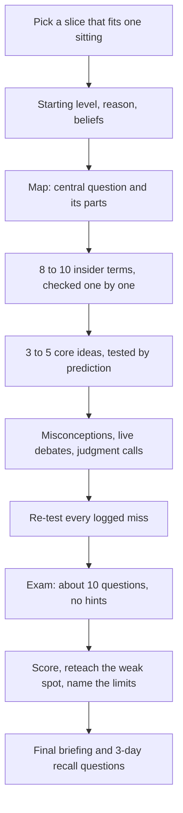

# Up to Speed

 

  

Gets you up to speed on an unfamiliar field in one sitting (roughly 45-90 minutes, shorter on request), one question at a time: the field's map, the 8-10 terms insiders use, the 3-5 ideas that explain most of it, live debates, and a scored exam with no hints. Use with "get me up to speed on", "crash course", "brief me on", or before a meeting in an industry you don't know.

## What it looks like

One sitting, one question at a time. Every round ends with a check, and every miss is logged and re-tested before the exam:

Each exam answer is marked solid (1), partial (½), or missed (0). The suggested bands are rough defaults, not calibrated thresholds:

| Score | What it means |
|---|---|
| 80% or more | You can hold your own in a conversation with an insider. |
| 50-79% | You can follow along. |
| Under 50% | Not there yet. |

Short on time? The session drops to 5-6 terms, 3 core ideas, a 6-question exam, and no retest, and says what was cut.

## Install

Copy this complete folder to `~/.claude/skills/up-to-speed/` for Claude Code (CLI and local desktop sessions), or to `~/.agents/skills/up-to-speed/` for Codex, Gemini CLI, Cursor, GitHub Copilot and OpenCode. For one repository only, copy it to `.claude/skills/up-to-speed/` or `.agents/skills/up-to-speed/` (Windsurf also reads `.agents/skills`); Cline reads `.cline/skills/up-to-speed/` or `.claude/skills/up-to-speed/`. See the [collection README](../../../../README.md#install) for current platform notes.

## Contents

- `SKILL.md` — skill instructions and metadata.
- `VERSION` and `CHANGELOG.md` — package version history.

