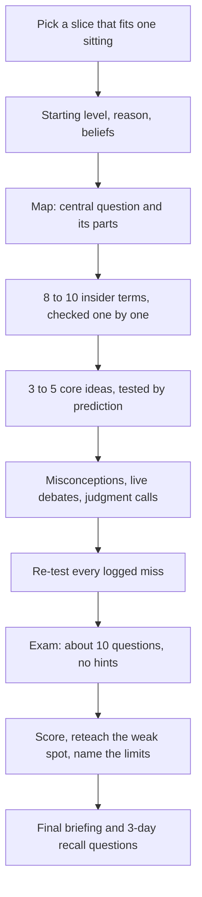

# Up to Speed

[](../../../../LICENSE) [](CHANGELOG.md)

[](../../../../README.md#compatibility) [](../../../../README.md#compatibility) [](../../../../README.md#compatibility)

Gets you up to speed on an unfamiliar field in one sitting (roughly 45-90 minutes, shorter on request), one question at a time: the field's map, the 8-10 terms insiders use, the 3-5 ideas that explain most of it, live debates, and a scored exam with no hints. Use with "get me up to speed on", "crash course", "brief me on", or before a meeting in an industry you don't know.

## When and how to use it

**Use it when**
- You have a meeting tomorrow with a client in an industry you do not know.
- You start a new job and hear terms you cannot follow.
- You keep hearing about a topic and want the core in one sitting.

**Try it**

```text
/up-to-speed freight logistics
Get me up to speed on carbon credits. I have 30 minutes.
```

A live session, one question at a time, with a no-hints exam at the end. Then a written briefing with the map, key terms, core ideas, debates, your score, your weak spot and three recall questions. With less time, the agent shortens the plan. Other agents can ask in words.

**Skip it when**
- You need one fact or a source summary. Ask the question directly.

## What it looks like

One sitting, one question at a time. Every round ends with a check, and every miss is logged and re-tested before the exam:



Each exam answer is marked solid (1), partial (½), or missed (0). The suggested bands are rough defaults, not calibrated thresholds:

| Score | What it means |
|---|---|
| 80% or more | You can hold your own in a conversation with an insider. |
| 50-79% | You can follow along. |
| Under 50% | Not there yet. |

Short on time? The session drops to 5-6 terms, 3 core ideas, a 6-question exam, and no retest, and says what was cut.

## Install

<!-- install:begin -->
Pick your platform. Steps expand below. The [Install section of the collection README](../../../../README.md#install) has the full guide.

<details>
<summary><b>Claude Code (terminal CLI)</b> — recommended</summary>

```bash
claude plugin marketplace add evemcgivern/agent-skills
claude plugin install agent-workflow@evemcgivern-skills
```

This installs the whole `agent-workflow` plugin, so you also get its other skills: `agent-doctor`, `ambition`, `check-worth`, `efficient-frontier-routing`, `fable-chief-agent`, `goal-checklist`, `handoff`, `mission`, `orchestrator`, `problem-first`, `quick-recap`, `sonnet-prompt-improver`, `stay-within-limits`. Run it as `/agent-workflow:up-to-speed`. Inside a session, the same thing is `/plugin marketplace add evemcgivern/agent-skills`, then `/plugin install agent-workflow@evemcgivern-skills`.

Update later with `claude plugin marketplace update evemcgivern-skills`, then `claude plugin update agent-workflow@evemcgivern-skills`.

To install only this skill, copy it from a clone of the repo:

```bash
git clone https://github.com/evemcgivern/agent-skills.git && cd agent-skills
scripts/install.sh up-to-speed   # into ~/.claude/skills/up-to-speed
```

Add `--project <repo-path>` for one repository only, or `--force` to replace a copy you already have.

</details>

<details>
<summary><b>Claude Code desktop app</b></summary>

In a local Code session choose **+ → Plugins → Add plugin**, enter `evemcgivern/agent-skills` as the marketplace, then install **agent-workflow** (it brings the plugin's other skills too).

Local desktop and CLI sessions share user-scope installs. Cloud Code sessions do not load local plugins; commit this skill folder to your repository's `.claude/skills/up-to-speed/` instead.

</details>

<details>
<summary><b>Codex (CLI, IDE extension, desktop app)</b></summary>

```bash
git clone https://github.com/evemcgivern/agent-skills.git && cd agent-skills
scripts/install.sh --target codex up-to-speed   # into ~/.agents/skills/up-to-speed
```

Add `--project <repo-path>` to install into that repository's `.agents/skills/up-to-speed/` instead. Or copy this folder by hand to `~/.agents/skills/up-to-speed/`, or `.agents/skills/up-to-speed/` in a repository; keep every file in it together. Start a new session and invoke the skill by name. See the [Codex skills docs](https://developers.openai.com/codex/skills-and-plugins).

</details>

<details>
<summary><b>Other agents: Gemini CLI, Antigravity CLI, Cursor, GitHub Copilot, Windsurf, OpenCode, Cline</b></summary>

These agents load `SKILL.md` folders directly. Copy this whole folder to the place your agent reads:

- Gemini CLI, Antigravity CLI, Cursor, GitHub Copilot, OpenCode: `~/.agents/skills/up-to-speed/` for personal use (`scripts/install.sh --target codex up-to-speed` does this), or `<repo>/.agents/skills/up-to-speed/` for one repository.
- Windsurf: `<repo>/.agents/skills/up-to-speed/`.
- Cline: `<repo>/.cline/skills/up-to-speed/`, `<repo>/.claude/skills/up-to-speed/` or `~/.cline/skills/up-to-speed/`.

</details>

<details>
<summary><b>Claude app (claude.ai)</b></summary>

1. Zip this folder from a clone of the repo (the ZIP must contain the folder itself, with `SKILL.md` inside):
   ```bash
   cd plugins/agent-workflow/skills && zip -r up-to-speed.zip up-to-speed
   ```
2. Turn on code execution under **Settings → Capabilities**.
3. Open **Customize → Skills → + → Create skill → Upload a skill** and upload `up-to-speed.zip`.

On Enterprise, an owner must first enable skills under Organization settings. The same upload works in Claude Cowork. Local `~/.claude/skills/` files do not sync to Claude.ai, so the upload is needed; or commit the folder to a project repository's `.claude/skills/`.

</details>

<details>
<summary><b>ChatGPT</b></summary>

1. Skills in ChatGPT are in beta and available on Business, Enterprise, Edu, Teachers and Healthcare plans, not on personal Free, Plus or Pro plans. On Enterprise and Edu, a workspace admin must first turn skills on and allow skill uploading.
2. Zip this folder (the ZIP must contain the folder itself, with `SKILL.md` inside):
   ```bash
   cd plugins/agent-workflow/skills && zip -r up-to-speed.zip up-to-speed
   ```
3. Open the **Plugins → Skills** tab, choose **+ → Upload from your computer** and upload the ZIP. ChatGPT scans each upload and can mark it Needs Review or Blocked.

The web and desktop apps do not sync skills. Menu labels change, so OpenAI's [Skills in ChatGPT](https://help.openai.com/en/articles/20001066-skills-in-chatgpt) article is the source of truth. ChatGPT runs skills in a remote sandbox with no access to your local files, repo or local shell. On other plans, use Codex, which reads skill folders directly.

</details>

<!-- install:end -->

## Contents

- `SKILL.md` — skill instructions and metadata.
- `VERSION` and `CHANGELOG.md` — package version history.

