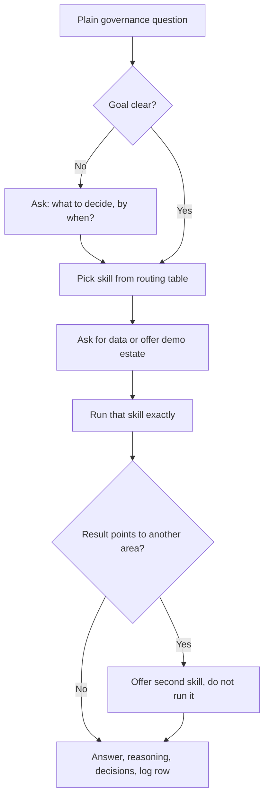

# App Governance

    

Pick the right governance skill for a plain request about a software estate, AI systems, access, or devices, ask for the data, run that skill, and hand every decision back to a person. Use when someone has a governance question but has not chosen a tool.

## What it looks like

The router never decides. It picks one of the eight skills, runs it, and hands the decisions back:

For example, an access review on the demo estate flags account ACC-104 on APP-044, whose license LIC-044 expired in 2025. The router reports the access finding and then offers `rationalization` for the license, without running it. The [tools page](https://evemcgivern.github.io/app-governance-kit/tools.html) shows the router next to each skill it can call.

## Install

See the [repository README](../../../../README.md#install) for Claude Code, Codex, Claude.ai and ChatGPT steps.

## Included

- `SKILL.md` and all workflow reference/template files:
- `SKILL.md`
- `checklist.md`
- `crosswalk.csv`
- `platform-guide.md`
- `sop.md`
- `template.csv`
- `themes.md`
- `agents/openai.yaml` for ChatGPT/Codex skill-card metadata.
- `VERSION` and `CHANGELOG.md` for this package snapshot.

Source: [https://github.com/evemcgivern/app-governance-kit](https://github.com/evemcgivern/app-governance-kit).
