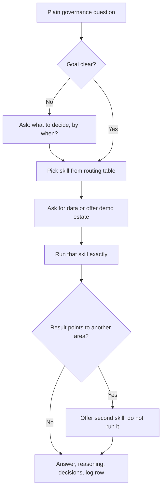

# App Governance

 

[](../../../../README.md#compatibility) [](../../../../README.md#compatibility) [](../../../../README.md#compatibility)
> In ChatGPT, opening a second uploaded skill is not verified, so it names the skill for you to open.

Pick the right governance skill for a plain request about a software estate, AI systems, access, or devices, ask for the data, run that skill, and hand every decision back to a person. Use when someone has a governance question but has not chosen a tool.

## What it looks like

The router never decides. It picks one of the eight skills, runs it, and hands the decisions back:



For example, an access review on the demo estate flags account ACC-104 on APP-044, whose license LIC-044 expired in 2025. The router reports the access finding and then offers `rationalization` for the license, without running it. The [tools page](https://evemcgivern.github.io/app-governance-kit/tools.html) shows the router next to each skill it can call.

## Install

<!-- install:begin -->
Pick your platform. Steps expand below. The [Install section of the collection README](../../../../README.md#install) has the full guide.

<details>
<summary><b>Claude Code (terminal CLI)</b> — recommended</summary>

```bash
claude plugin marketplace add evemcgivern/agent-skills
claude plugin install app-governance-kit@evemcgivern-skills
```

This installs the whole `app-governance-kit` plugin, so you also get its other skills: `access-review`, `ai-intake`, `cert-prep`, `crosswalk`, `hardware-lifecycle`, `itam-maturity`, `program-setup`, `rationalization`. Run it as `/app-governance-kit:app-governance`. Inside a session, the same thing is `/plugin marketplace add evemcgivern/agent-skills`, then `/plugin install app-governance-kit@evemcgivern-skills`.

Update later with `claude plugin marketplace update evemcgivern-skills`, then `claude plugin update app-governance-kit@evemcgivern-skills`.

To install only this skill, copy it from a clone of the repo:

```bash
git clone https://github.com/evemcgivern/agent-skills.git && cd agent-skills
scripts/install.sh app-governance   # into ~/.claude/skills/app-governance
```

Add `--project <repo-path>` for one repository only, or `--force` to replace a copy you already have.

The router runs the kit's other skills, so all nine must be installed together. The plugin install does that. For single-skill copies, copy all nine: `scripts/install.sh access-review ai-intake app-governance cert-prep crosswalk hardware-lifecycle itam-maturity program-setup rationalization`.

</details>

<details>
<summary><b>Claude Code desktop app</b></summary>

In a local Code session choose **+ → Plugins → Add plugin**, enter `evemcgivern/agent-skills` as the marketplace, then install **app-governance-kit** (it brings the plugin's other skills too).

Local desktop and CLI sessions share user-scope installs. Cloud Code sessions do not load local plugins; commit this skill folder to your repository's `.claude/skills/app-governance/` instead.

</details>

<details>
<summary><b>Codex (CLI, IDE extension, desktop app)</b></summary>

```bash
git clone https://github.com/evemcgivern/agent-skills.git && cd agent-skills
scripts/install.sh --target codex app-governance   # into ~/.agents/skills/app-governance
```

Add `--project <repo-path>` to install into that repository's `.agents/skills/app-governance/` instead. Or copy this folder by hand to `~/.agents/skills/app-governance/`, or `.agents/skills/app-governance/` in a repository; keep every file in it together. Start a new session and invoke the skill by name. See the [Codex skills docs](https://developers.openai.com/codex/skills-and-plugins).

The router runs the kit's other skills, so install all nine together: `scripts/install.sh --target codex access-review ai-intake app-governance cert-prep crosswalk hardware-lifecycle itam-maturity program-setup rationalization`.

</details>

<details>
<summary><b>Other agents: Gemini CLI, Antigravity CLI, Cursor, GitHub Copilot, Windsurf, OpenCode, Cline</b></summary>

These agents load `SKILL.md` folders directly. Copy this whole folder to the place your agent reads:

- Gemini CLI, Antigravity CLI, Cursor, GitHub Copilot, OpenCode: `~/.agents/skills/app-governance/` for personal use (`scripts/install.sh --target codex app-governance` does this), or `<repo>/.agents/skills/app-governance/` for one repository.
- Windsurf: `<repo>/.agents/skills/app-governance/`.
- Cline: `<repo>/.cline/skills/app-governance/`, `<repo>/.claude/skills/app-governance/` or `~/.cline/skills/app-governance/`.

The router runs the kit's other skills, so copy all nine kit skill folders into the same skills folder.

</details>

<details>
<summary><b>Claude app (claude.ai)</b></summary>

1. Zip this folder from a clone of the repo (the ZIP must contain the folder itself, with `SKILL.md` inside):
   ```bash
   cd plugins/app-governance-kit/skills && zip -r app-governance.zip app-governance
   ```
2. Turn on code execution under **Settings → Capabilities**.
3. Open **Customize → Skills → + → Create skill → Upload a skill** and upload `app-governance.zip`.

On Enterprise, an owner must first enable skills under Organization settings. The same upload works in Claude Cowork. Local `~/.claude/skills/` files do not sync to Claude.ai, so the upload is needed; or commit the folder to a project repository's `.claude/skills/`.

Upload all nine kit skills, one ZIP each, so the router can run the one it picks.

</details>

<details>
<summary><b>ChatGPT</b> — works with a limit</summary>

1. Skills in ChatGPT are in beta and available on Business, Enterprise, Edu, Teachers and Healthcare plans, not on personal Free, Plus or Pro plans. On Enterprise and Edu, a workspace admin must first turn skills on and allow skill uploading.
2. Zip this folder (the ZIP must contain the folder itself, with `SKILL.md` inside):
   ```bash
   cd plugins/app-governance-kit/skills && zip -r app-governance.zip app-governance
   ```
3. Open the **Plugins → Skills** tab, choose **+ → Upload from your computer** and upload the ZIP. ChatGPT scans each upload and can mark it Needs Review or Blocked.

The web and desktop apps do not sync skills. Menu labels change, so OpenAI's [Skills in ChatGPT](https://help.openai.com/en/articles/20001066-skills-in-chatgpt) article is the source of truth. ChatGPT runs skills in a remote sandbox with no access to your local files, repo or local shell. On other plans, use Codex, which reads skill folders directly.

**Limit:** Opening a second uploaded skill is not verified in ChatGPT, so it names the skill for you to open.

In ChatGPT each kit skill is a separate upload, and opening a second skill from this router is not verified, so it names the skill for you to open instead.

</details>

With no data of your own, the router offers the fictional Halden demo estate. A single-skill install does not include it; download the files from [`demo-estate/`](https://github.com/evemcgivern/agent-skills/tree/main/plugins/app-governance-kit/demo-estate).

The kit's full site, with visuals and an interactive practicum: https://evemcgivern.github.io/app-governance-kit/

<!-- install:end -->

## Included

- `SKILL.md` and all workflow reference/template files:
- `SKILL.md`
- `checklist.md`
- `crosswalk.csv`
- `platform-guide.md`
- `sop.md`
- `template.csv`
- `themes.md`
- `agents/openai.yaml` for ChatGPT/Codex skill-card metadata.
- `VERSION` and `CHANGELOG.md` for this package snapshot.

Source: [https://github.com/evemcgivern/app-governance-kit](https://github.com/evemcgivern/app-governance-kit).
