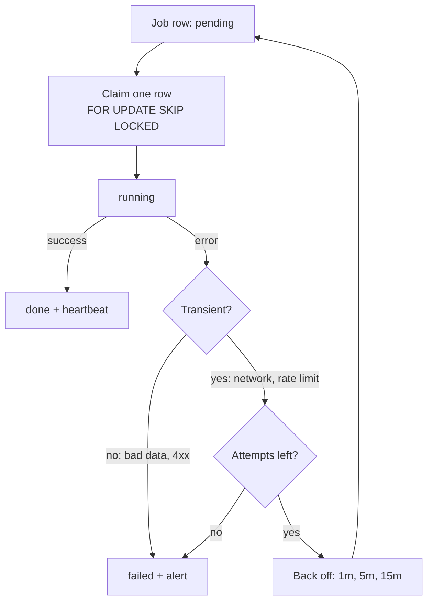

# Background Jobs

[](../../../../LICENSE) [](CHANGELOG.md)

[](../../../../README.md#compatibility) [](../../../../README.md#compatibility) [](../../../../README.md#compatibility)

Designs scheduled and background work on Render: when to use a cron job and when to use a long-running worker, how to make jobs idempotent, how to claim jobs from a Postgres queue table, retries with backoff, timeout budgets, catch-up after missed runs, and heartbeat monitoring so a failed job raises an alert instead of failing silently. Use it when asked to set up a cron job, build a background worker, or find out why a nightly job failed without anyone noticing.

## When and how to use it

**Use it when**
- You need a nightly report job on Render and cannot tell if it is a cron job or a worker.
- A 3am job failed and nobody knew until a customer wrote in.
- Two workers pick the same row from a Postgres queue table.

**Try it**
```text
Design a nightly cron job on Render that emails a usage digest. Make it safe to run twice.
Our invoice sync worker sometimes handles the same row twice. Show me how to claim jobs safely and add a heartbeat alert.
```
You get the job code and a short runbook note: schedule, expected duration, what the heartbeat alert means, and how to re-run it by hand.

**Skip it when**
- The work must react within seconds of an event and fits a request timeout. Use a webhook route handler instead.

## What it looks like

The life of one job pulled from a Postgres queue table. A worker claims exactly one row in a single statement, so two workers never take the same job. Only transient errors are retried, with a capped backoff; anything else, or a job that runs out of attempts, is marked `failed` and raises an alert instead of disappearing:



Choosing the shape before writing any code:

| | Cron job | Background worker |
|---|---|---|
| Runs | On a schedule, then exits | All the time, polling a queue or holding a connection |
| Billed | Per second of run time | Around the clock, busy or idle |
| Fits | Nightly rollups, digest emails, cleanup sweeps | Work that must react within seconds |

Every job, either shape, sends a heartbeat when it starts and when it ends, including on failure. A missed check-in is the alert.

## Install

<!-- install:begin -->
Pick your platform. Steps expand below. The [Install section of the collection README](../../../../README.md#install) has the full guide.

<details>
<summary><b>Claude Code (terminal CLI)</b> — recommended</summary>

```bash
claude plugin marketplace add evemcgivern/agent-skills
claude plugin install engineering-practices@evemcgivern-skills
```

This installs the whole `engineering-practices` plugin, so you also get its other skills: `audit-background-processes`, `launch-chrome-debug`, `llm-engineer`, `review-older-issues`, `saas-metrics`, `service-debugging`, `spec-workflow`, `spec-workflow-drift`, `transactional-email`. Run it as `/engineering-practices:background-jobs`. Inside a session, the same thing is `/plugin marketplace add evemcgivern/agent-skills`, then `/plugin install engineering-practices@evemcgivern-skills`.

Update later with `claude plugin marketplace update evemcgivern-skills`, then `claude plugin update engineering-practices@evemcgivern-skills`.

To install only this skill, copy it from a clone of the repo:

```bash
git clone https://github.com/evemcgivern/agent-skills.git && cd agent-skills
scripts/install.sh background-jobs   # into ~/.claude/skills/background-jobs
```

Add `--project <repo-path>` for one repository only, or `--force` to replace a copy you already have.

</details>

<details>
<summary><b>Claude Code desktop app</b></summary>

In a local Code session choose **+ → Plugins → Add plugin**, enter `evemcgivern/agent-skills` as the marketplace, then install **engineering-practices** (it brings the plugin's other skills too).

Local desktop and CLI sessions share user-scope installs. Cloud Code sessions do not load local plugins; commit this skill folder to your repository's `.claude/skills/background-jobs/` instead.

</details>

<details>
<summary><b>Codex (CLI, IDE extension, desktop app)</b></summary>

```bash
git clone https://github.com/evemcgivern/agent-skills.git && cd agent-skills
scripts/install.sh --target codex background-jobs   # into ~/.agents/skills/background-jobs
```

Add `--project <repo-path>` to install into that repository's `.agents/skills/background-jobs/` instead. Or copy this folder by hand to `~/.agents/skills/background-jobs/`, or `.agents/skills/background-jobs/` in a repository; keep every file in it together. Start a new session and invoke the skill by name. See the [Codex skills docs](https://developers.openai.com/codex/skills-and-plugins).

</details>

<details>
<summary><b>Other agents: Gemini CLI, Antigravity CLI, Cursor, GitHub Copilot, Windsurf, OpenCode, Cline</b></summary>

These agents load `SKILL.md` folders directly. Copy this whole folder to the place your agent reads:

- Gemini CLI, Antigravity CLI, Cursor, GitHub Copilot, OpenCode: `~/.agents/skills/background-jobs/` for personal use (`scripts/install.sh --target codex background-jobs` does this), or `<repo>/.agents/skills/background-jobs/` for one repository.
- Windsurf: `<repo>/.agents/skills/background-jobs/`.
- Cline: `<repo>/.cline/skills/background-jobs/`, `<repo>/.claude/skills/background-jobs/` or `~/.cline/skills/background-jobs/`.

</details>

<details>
<summary><b>Claude app (claude.ai)</b></summary>

1. Zip this folder from a clone of the repo (the ZIP must contain the folder itself, with `SKILL.md` inside):
   ```bash
   cd plugins/engineering-practices/skills && zip -r background-jobs.zip background-jobs
   ```
2. Turn on code execution under **Settings → Capabilities**.
3. Open **Customize → Skills → + → Create skill → Upload a skill** and upload `background-jobs.zip`.

On Enterprise, an owner must first enable skills under Organization settings. The same upload works in Claude Cowork. Local `~/.claude/skills/` files do not sync to Claude.ai, so the upload is needed; or commit the folder to a project repository's `.claude/skills/`.

</details>

<details>
<summary><b>ChatGPT</b></summary>

1. Skills in ChatGPT are in beta and available on Business, Enterprise, Edu, Teachers and Healthcare plans, not on personal Free, Plus or Pro plans. On Enterprise and Edu, a workspace admin must first turn skills on and allow skill uploading.
2. Zip this folder (the ZIP must contain the folder itself, with `SKILL.md` inside):
   ```bash
   cd plugins/engineering-practices/skills && zip -r background-jobs.zip background-jobs
   ```
3. Open the **Plugins → Skills** tab, choose **+ → Upload from your computer** and upload the ZIP. ChatGPT scans each upload and can mark it Needs Review or Blocked.

The web and desktop apps do not sync skills. Menu labels change, so OpenAI's [Skills in ChatGPT](https://help.openai.com/en/articles/20001066-skills-in-chatgpt) article is the source of truth. ChatGPT runs skills in a remote sandbox with no access to your local files, repo or local shell. On other plans, use Codex, which reads skill folders directly.

</details>

<!-- install:end -->

## Contents

- `SKILL.md` — skill instructions and metadata.
- `VERSION` and `CHANGELOG.md` — package version history.
