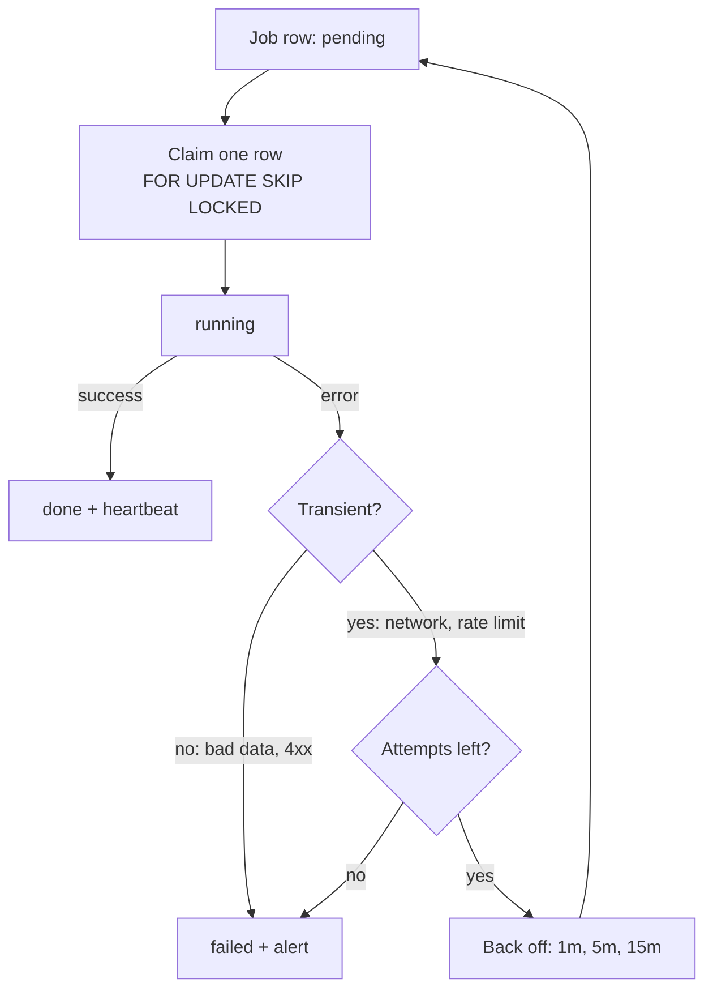

# Background Jobs

 

  

Designs scheduled and background work on Render: when to use a cron job and when to use a long-running worker, how to make jobs idempotent, how to claim jobs from a Postgres queue table, retries with backoff, timeout budgets, catch-up after missed runs, and heartbeat monitoring so a failed job raises an alert instead of failing silently. Use it when asked to set up a cron job, build a background worker, or find out why a nightly job failed without anyone noticing.

## What it looks like

The life of one job pulled from a Postgres queue table. A worker claims exactly one row in a single statement, so two workers never take the same job. Only transient errors are retried, with a capped backoff; anything else, or a job that runs out of attempts, is marked `failed` and raises an alert instead of disappearing:

Choosing the shape before writing any code:

| | Cron job | Background worker |
|---|---|---|
| Runs | On a schedule, then exits | All the time, polling a queue or holding a connection |
| Billed | Per second of run time | Around the clock, busy or idle |
| Fits | Nightly rollups, digest emails, cleanup sweeps | Work that must react within seconds |

Every job, either shape, sends a heartbeat when it starts and when it ends, including on failure. A missed check-in is the alert.

## Install

See [Install](../../../../README.md#install) in the collection README. Copy this complete folder; supporting files in it may be required.

## Contents

- `SKILL.md` — skill instructions and metadata.
- `VERSION` and `CHANGELOG.md` — package version history.
