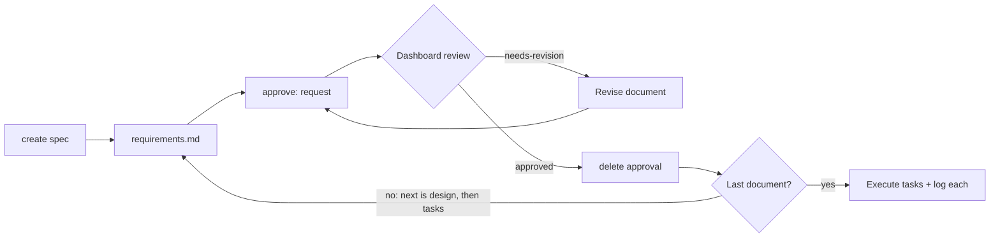

# Spec Workflow

[](../../../../LICENSE) [](CHANGELOG.md)

[](../../../../README.md#compatibility) [](../../../../README.md#compatibility) [](../../../../README.md#compatibility)
> The Claude app and ChatGPT cannot run it: they cannot run the local spec-workflow MCP server or read your specs.

> **Requires the [spec-workflow MCP server](https://github.com/Pimzino/spec-workflow-mcp)** by Pimzino. Install and configure it first. This skill only calls the server's tools (`spec-workflow-guide`, `steering-guide`, `spec-status`, `approvals`, `log-implementation`) and reads the `.spec-workflow/` files it manages. This skill contains none of the server's code; the server is a separate project under its own license (GPL-3.0 at the time of writing).

Drives spec-driven development through the spec-workflow MCP server: create a spec, request approval for requirements, design and tasks through the server's dashboard, check progress, execute one task or a range from `tasks.md`, and log each implementation before marking it done. It reads project guidance files such as `CLAUDE.md`, `AGENTS.md` and `vision.md` and follows their build and commit rules. Use on `/spec-workflow` or when asked to "create a spec", "check the spec status", "execute task 1.2", or "run tasks 1.3-1.6".

## When and how to use it

**Use it when**
- You start a feature and need requirements, design and tasks approved in order.
- You return to a project and need to see which spec tasks are done.
- You finished a task and need to log what you built.

**Try it**
```text
/spec-workflow status checkout-flow
Execute task 1.2 of the checkout-flow spec and log the implementation.
```
You get status or task work through the spec-workflow MCP server. Approvals happen in its dashboard, because "approved" in chat does not count. Other agents can ask in words.

**Skip it when**
- You do not run the spec-workflow MCP server. This skill does nothing without it.

## What it looks like

Each spec document goes through the same approval loop before the next one is written: requirements, then design, then tasks. Approval happens in the server's dashboard or editor extension; a "looks good" typed in chat does not count:



During implementation, each task moves through three marks in `tasks.md`:

| Mark | Meaning |
|---|---|
| `[ ]` | Pending |
| `[-]` | In progress |
| `[x]` | Done, set only after the implementation log entry is written |

## Install

<!-- install:begin -->
Pick your platform. Steps expand below. The [Install section of the collection README](../../../../README.md#install) has the full guide.

<details>
<summary><b>Claude Code (terminal CLI)</b> — recommended</summary>

```bash
claude plugin marketplace add evemcgivern/agent-skills
claude plugin install engineering-practices@evemcgivern-skills
```

This installs the whole `engineering-practices` plugin, so you also get its other skills: `audit-background-processes`, `background-jobs`, `launch-chrome-debug`, `llm-engineer`, `review-older-issues`, `saas-metrics`, `service-debugging`, `spec-workflow-drift`, `transactional-email`. Run it as `/engineering-practices:spec-workflow`. Inside a session, the same thing is `/plugin marketplace add evemcgivern/agent-skills`, then `/plugin install engineering-practices@evemcgivern-skills`.

Update later with `claude plugin marketplace update evemcgivern-skills`, then `claude plugin update engineering-practices@evemcgivern-skills`.

To install only this skill, copy it from a clone of the repo:

```bash
git clone https://github.com/evemcgivern/agent-skills.git && cd agent-skills
scripts/install.sh spec-workflow   # into ~/.claude/skills/spec-workflow
```

Add `--project <repo-path>` for one repository only, or `--force` to replace a copy you already have.

</details>

<details>
<summary><b>Claude Code desktop app</b></summary>

In a local Code session choose **+ → Plugins → Add plugin**, enter `evemcgivern/agent-skills` as the marketplace, then install **engineering-practices** (it brings the plugin's other skills too).

Local desktop and CLI sessions share user-scope installs. Cloud Code sessions do not load local plugins; commit this skill folder to your repository's `.claude/skills/spec-workflow/` instead.

</details>

<details>
<summary><b>Codex (CLI, IDE extension, desktop app)</b></summary>

```bash
git clone https://github.com/evemcgivern/agent-skills.git && cd agent-skills
scripts/install.sh --target codex spec-workflow   # into ~/.agents/skills/spec-workflow
```

Add `--project <repo-path>` to install into that repository's `.agents/skills/spec-workflow/` instead. Or copy this folder by hand to `~/.agents/skills/spec-workflow/`, or `.agents/skills/spec-workflow/` in a repository; keep every file in it together. Start a new session and invoke the skill by name. See the [Codex skills docs](https://developers.openai.com/codex/skills-and-plugins).

</details>

<details>
<summary><b>Other agents: Gemini CLI, Antigravity CLI, Cursor, GitHub Copilot, Windsurf, OpenCode, Cline</b></summary>

These agents load `SKILL.md` folders directly. Copy this whole folder to the place your agent reads:

- Gemini CLI, Antigravity CLI, Cursor, GitHub Copilot, OpenCode: `~/.agents/skills/spec-workflow/` for personal use (`scripts/install.sh --target codex spec-workflow` does this), or `<repo>/.agents/skills/spec-workflow/` for one repository.
- Windsurf: `<repo>/.agents/skills/spec-workflow/`.
- Cline: `<repo>/.cline/skills/spec-workflow/`, `<repo>/.claude/skills/spec-workflow/` or `~/.cline/skills/spec-workflow/`.

</details>

<details>
<summary><b>Claude app: not supported</b></summary>

The Claude app cannot run the local spec-workflow MCP server or read your specs.

Use Claude Code or Codex on your computer instead.

</details>

<details>
<summary><b>ChatGPT: not supported</b></summary>

ChatGPT cannot run the local spec-workflow MCP server or read your specs.

Use Claude Code or Codex on your computer instead.

</details>

<!-- install:end -->

## Contents

- `SKILL.md` — skill instructions and metadata.
- `instructions.md` — full behavior for each command.
- `approval-workflow.md` — the create and approval sequence.
- `batch-execution.md` — running a range or list of tasks.
- `examples.md` — worked examples.
- `help-template.md` — the help menu shown with no arguments.
- `VERSION` and `CHANGELOG.md` — package version history.
