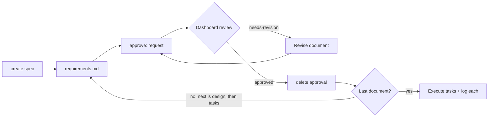

# Spec Workflow

 

  
> Claude: Works in Claude Code with the spec-workflow MCP server; the Claude app cannot run that server or read your specs. Codex / ChatGPT: Works in Codex with the spec-workflow MCP server; ChatGPT cannot run it or read your repo.

> **Requires the [spec-workflow MCP server](https://github.com/Pimzino/spec-workflow-mcp)** by Pimzino. Install and configure it first. This skill only calls the server's tools (`spec-workflow-guide`, `steering-guide`, `spec-status`, `approvals`, `log-implementation`) and reads the `.spec-workflow/` files it manages. This skill contains none of the server's code; the server is a separate project under its own license (GPL-3.0 at the time of writing).

Drives spec-driven development through the spec-workflow MCP server: create a spec, request approval for requirements, design and tasks through the server's dashboard, check progress, execute one task or a range from `tasks.md`, and log each implementation before marking it done. It reads project guidance files such as `CLAUDE.md`, `AGENTS.md` and `vision.md` and follows their build and commit rules. Use on `/spec-workflow` or when asked to "create a spec", "check the spec status", "execute task 1.2", or "run tasks 1.3-1.6".

## What it looks like

Each spec document goes through the same approval loop before the next one is written: requirements, then design, then tasks. Approval happens in the server's dashboard or editor extension; a "looks good" typed in chat does not count:

During implementation, each task moves through three marks in `tasks.md`:

| Mark | Meaning |
|---|---|
| `[ ]` | Pending |
| `[-]` | In progress |
| `[x]` | Done, set only after the implementation log entry is written |

## Install

See [Install](../../../../README.md#install) in the collection README. Copy this complete folder as `spec-workflow/`; keep every file in it together.

## Contents

- `SKILL.md` — skill instructions and metadata.
- `instructions.md` — full behavior for each command.
- `approval-workflow.md` — the create and approval sequence.
- `batch-execution.md` — running a range or list of tasks.
- `examples.md` — worked examples.
- `help-template.md` — the help menu shown with no arguments.
- `VERSION` and `CHANGELOG.md` — package version history.
