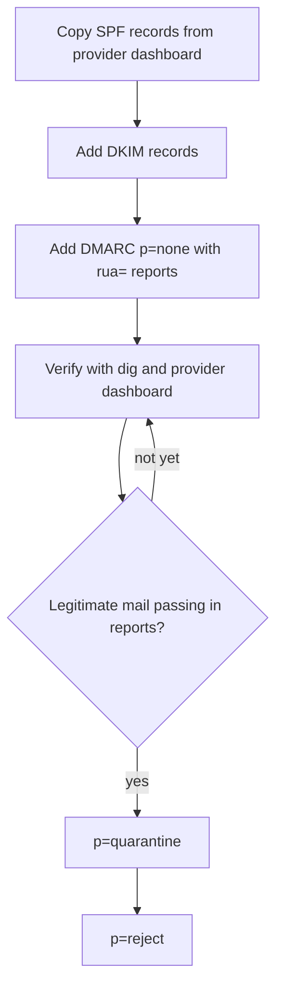

# Transactional Email

[](../../../../LICENSE) [](CHANGELOG.md)

[](../../../../README.md#compatibility) [](../../../../README.md#compatibility) [](../../../../README.md#compatibility)
> In the Claude app and ChatGPT you run the DNS checks yourself.

Sets up and audits the email that sits under account creation, password resets, receipts, and product notifications. It covers choosing between Resend and Postmark, SPF, DKIM, and DMARC with verification commands, keeping templates in code, deliverability testing, the transactional-versus-marketing compliance line, and unsubscribe handling. Use it when asked to set up email, to find out why email lands in spam, to add a template, or to audit deliverability.

## What it looks like

The order for authenticating a sending domain. DMARC starts in report-only mode and tightens only after the reports show your own mail passing; jumping straight to `p=reject` can silently drop password resets and receipts:



Which kind of email you are sending decides the rules it follows:

| | Transactional | Marketing |
|---|---|---|
| Examples | Password reset, receipt, account verification, security alert | Announcements, newsletters, re-engagement |
| Consent | Not needed; triggered by the user's own action | Opt-in, or legitimate interest with easy opt-out, by jurisdiction |
| Unsubscribe link | Not required | Required on every send, one-click, honored promptly |

Promotional content riding on a receipt needs its own consent-respecting send.

## Install

<!-- install:begin -->
Pick your platform. Steps expand below. The [Install section of the collection README](../../../../README.md#install) has the full guide.

<details>
<summary><b>Claude Code (terminal CLI)</b> — recommended</summary>

```bash
claude plugin marketplace add evemcgivern/agent-skills
claude plugin install engineering-practices@evemcgivern-skills
```

This installs the whole `engineering-practices` plugin, so you also get its other skills: `audit-background-processes`, `background-jobs`, `launch-chrome-debug`, `llm-engineer`, `review-older-issues`, `saas-metrics`, `service-debugging`, `spec-workflow`, `spec-workflow-drift`. Run it as `/engineering-practices:transactional-email`. Inside a session, the same thing is `/plugin marketplace add evemcgivern/agent-skills`, then `/plugin install engineering-practices@evemcgivern-skills`.

Update later with `claude plugin marketplace update evemcgivern-skills`, then `claude plugin update engineering-practices@evemcgivern-skills`.

To install only this skill, copy it from a clone of the repo:

```bash
git clone https://github.com/evemcgivern/agent-skills.git && cd agent-skills
scripts/install.sh transactional-email   # into ~/.claude/skills/transactional-email
```

Add `--project <repo-path>` for one repository only, or `--force` to replace a copy you already have.

</details>

<details>
<summary><b>Claude Code desktop app</b></summary>

In a local Code session choose **+ → Plugins → Add plugin**, enter `evemcgivern/agent-skills` as the marketplace, then install **engineering-practices** (it brings the plugin's other skills too).

Local desktop and CLI sessions share user-scope installs. Cloud Code sessions do not load local plugins; commit this skill folder to your repository's `.claude/skills/transactional-email/` instead.

</details>

<details>
<summary><b>Codex (CLI, IDE extension, desktop app)</b></summary>

```bash
git clone https://github.com/evemcgivern/agent-skills.git && cd agent-skills
scripts/install.sh --target codex transactional-email   # into ~/.agents/skills/transactional-email
```

Add `--project <repo-path>` to install into that repository's `.agents/skills/transactional-email/` instead. Or copy this folder by hand to `~/.agents/skills/transactional-email/`, or `.agents/skills/transactional-email/` in a repository; keep every file in it together. Start a new session and invoke the skill by name. See the [Codex skills docs](https://developers.openai.com/codex/skills-and-plugins).

</details>

<details>
<summary><b>Other agents: Gemini CLI, Antigravity CLI, Cursor, GitHub Copilot, Windsurf, OpenCode, Cline</b></summary>

These agents load `SKILL.md` folders directly. Copy this whole folder to the place your agent reads:

- Gemini CLI, Antigravity CLI, Cursor, GitHub Copilot, OpenCode: `~/.agents/skills/transactional-email/` for personal use (`scripts/install.sh --target codex transactional-email` does this), or `<repo>/.agents/skills/transactional-email/` for one repository.
- Windsurf: `<repo>/.agents/skills/transactional-email/`.
- Cline: `<repo>/.cline/skills/transactional-email/`, `<repo>/.claude/skills/transactional-email/` or `~/.cline/skills/transactional-email/`.

</details>

<details>
<summary><b>Claude app (claude.ai)</b> — works with a limit</summary>

1. Zip this folder from a clone of the repo (the ZIP must contain the folder itself, with `SKILL.md` inside):
   ```bash
   cd plugins/engineering-practices/skills && zip -r transactional-email.zip transactional-email
   ```
2. Turn on code execution under **Settings → Capabilities**.
3. Open **Customize → Skills → + → Create skill → Upload a skill** and upload `transactional-email.zip`.

On Enterprise, an owner must first enable skills under Organization settings. The same upload works in Claude Cowork. Local `~/.claude/skills/` files do not sync to Claude.ai, so the upload is needed; or commit the folder to a project repository's `.claude/skills/`.

**Limit:** The Claude app gives the setup and audit guidance, but you run the DNS checks yourself, because its network is limited to approved package sources and off for Team and Enterprise.

</details>

<details>
<summary><b>ChatGPT</b> — works with a limit</summary>

1. Skills in ChatGPT are in beta and available on Business, Enterprise, Edu, Teachers and Healthcare plans, not on personal Free, Plus or Pro plans. On Enterprise and Edu, a workspace admin must first turn skills on and allow skill uploading.
2. Zip this folder (the ZIP must contain the folder itself, with `SKILL.md` inside):
   ```bash
   cd plugins/engineering-practices/skills && zip -r transactional-email.zip transactional-email
   ```
3. Open the **Plugins → Skills** tab, choose **+ → Upload from your computer** and upload the ZIP. ChatGPT scans each upload and can mark it Needs Review or Blocked.

The web and desktop apps do not sync skills. Menu labels change, so OpenAI's [Skills in ChatGPT](https://help.openai.com/en/articles/20001066-skills-in-chatgpt) article is the source of truth. ChatGPT runs skills in a remote sandbox with no access to your local files, repo or local shell. On other plans, use Codex, which reads skill folders directly.

**Limit:** ChatGPT gives the setup and audit guidance, but you run the DNS checks yourself.

</details>

<!-- install:end -->

## Contents

- `SKILL.md` — skill instructions and metadata.
- `VERSION` and `CHANGELOG.md` — package version history.
