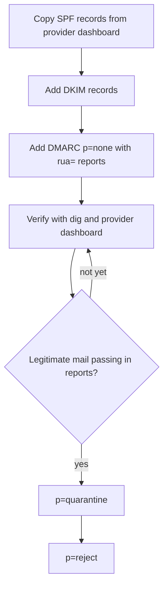

# Transactional Email

 

Sets up and audits the email that sits under account creation, password resets, receipts, and product notifications. It covers choosing between Resend and Postmark, SPF, DKIM, and DMARC with verification commands, keeping templates in code, deliverability testing, the transactional-versus-marketing compliance line, and unsubscribe handling. Use it when asked to set up email, to find out why email lands in spam, to add a template, or to audit deliverability.

## What it looks like

The order for authenticating a sending domain. DMARC starts in report-only mode and tightens only after the reports show your own mail passing; jumping straight to `p=reject` can silently drop password resets and receipts:

Which kind of email you are sending decides the rules it follows:

| | Transactional | Marketing |
|---|---|---|
| Examples | Password reset, receipt, account verification, security alert | Announcements, newsletters, re-engagement |
| Consent | Not needed; triggered by the user's own action | Opt-in, or legitimate interest with easy opt-out, by jurisdiction |
| Unsubscribe link | Not required | Required on every send, one-click, honored promptly |

Promotional content riding on a receipt needs its own consent-respecting send.

## Install

See [Install](../../../../README.md#install) in the collection README. Copy this complete folder; supporting files in it may be required.

## Contents

- `SKILL.md` — skill instructions and metadata.
- `VERSION` and `CHANGELOG.md` — package version history.
