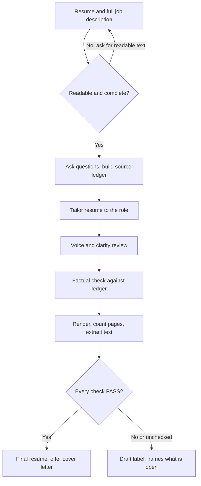

# RoleReady Application

 

[](../../../../README.md#compatibility) [](../../../../README.md#compatibility) [](../../../../README.md#compatibility)

Tailor a truthful resume and cover letter to one job, then review clarity, candidate voice, factual fidelity, and rendered documents.

## What it looks like

How a resume build moves from your documents to a file you can send:



The source ledger links every resume claim to a line of your original resume or an answer you gave. The check results come back next to the documents, never inside them. Example output, invented data:

```text
Resume checks (target: Operations Analyst, v01)
Readable and complete inputs      PASS
Source facts and role relevance   PASS
Rendered length (2 pages max)     UNVERIFIED  no renderer in this chat
Readability                       PASS
Layout                            UNVERIFIED  no renderer in this chat
Extraction                        UNVERIFIED  no file produced
Filename and target identity      PASS
Overall: UNVERIFIED, so the resume is labelled Draft.
Open question: was the 18% cost cut your project or the team's?
```

## Install

Pick your platform. Each section opens with one click.

| Platform | How | Format |
|---|---|---|
| Claude Code (terminal or desktop) | Plugin marketplace | Plugin |
| Codex (CLI, IDE, app) | Copy the folder | Skill folder |
| Claude app (claude.ai, Desktop, Cowork) | Upload | ZIP |
| ChatGPT | Upload, or paste | ZIP or `COPY-PASTE.txt` |
| Gemini CLI, Cursor, GitHub Copilot and other skill-folder agents | Copy the folder | Skill folder |
| Any other assistant | Paste | `COPY-PASTE.txt` |

<details>
<summary><b>Claude Code (terminal)</b></summary>

1. Add the marketplace: `claude plugin marketplace add evemcgivern/agent-skills`
2. Install the plugin: `claude plugin install role-ready-application@evemcgivern-skills`
3. Start a session and ask, for example, "tailor my resume to this job", then paste the job description. Or run `/role-ready-application:role-ready-application`.

<details>
<summary>More</summary>

- Update later: `claude plugin update role-ready-application@evemcgivern-skills`.
- Check it worked: `claude plugin list` shows `role-ready-application@evemcgivern-skills` as enabled.
</details>
</details>

<details>
<summary><b>Claude Code desktop app</b></summary>

1. Add the marketplace once from a terminal: `claude plugin marketplace add evemcgivern/agent-skills`.
2. In a local Code session choose **+ → Plugins → Add plugin**, then pick **role-ready-application**.
3. Ask for a resume or cover letter tailored to a job.

<details>
<summary>More</summary>

- The terminal and the desktop app's local sessions share user-scope installs.
- Cloud sessions do not load plugins installed on your computer.
</details>
</details>

<details>
<summary><b>Codex (CLI, IDE extension, desktop app)</b></summary>

1. Clone the repo: `git clone https://github.com/evemcgivern/agent-skills.git && cd agent-skills`
2. Copy the skill: `scripts/install.sh --target codex role-ready-application` (installs to `~/.agents/skills/role-ready-application`).
3. Start a new Codex session and ask for the skill by name.

<details>
<summary>More</summary>

- For one repository only, add `--project <repo-path>`.
- Or copy this folder by hand to `~/.agents/skills/role-ready-application/` (keep every file together).
- Restart Codex if the skill does not appear.
</details>
</details>

<details>
<summary><b>Claude app (claude.ai, Desktop chat, Cowork)</b></summary>

1. Zip this folder from a clone of the repo:
   ```bash
   cd plugins/role-ready-application/skills && zip -r role-ready-application.zip role-ready-application
   ```
2. Turn on code execution under **Settings → Capabilities**.
3. Open **Customize → Skills → + → Create skill → Upload a skill** and upload `role-ready-application.zip`.
4. Start a chat and attach your resume and the job description.

<details>
<summary>More</summary>

- On Enterprise, an owner must first enable skills under Organization settings.
- Local files in `~/.claude/skills/` do not sync to Claude.ai, so the upload is needed.
- To update, delete the skill and upload the new ZIP.
</details>
</details>

<details>
<summary><b>ChatGPT</b></summary>

1. Skills in ChatGPT are in beta and available on Business, Enterprise, Edu, Teachers and Healthcare plans, not on personal Free, Plus or Pro plans. Zip this folder as in the Claude app steps.
2. Open the **Plugins → Skills** tab, choose **+ → Upload from your computer** and upload the ZIP. ChatGPT scans each upload and can mark it Needs Review or Blocked.
3. In a chat, type `@` to pick the skill, and attach your resume and the job description.

<details>
<summary>More</summary>

- On Enterprise and Edu, a workspace admin must first turn skills on and allow skill uploading.
- The web and desktop apps do not sync skills.
- Menu labels change, so OpenAI's [Skills in ChatGPT](https://help.openai.com/en/articles/20001066-skills-in-chatgpt) article is the source of truth.
- No skill upload on your plan? Open a new chat or a project and paste the contents of [`COPY-PASTE.txt`](COPY-PASTE.txt) as the instructions, then attach your documents. It is the same workflow as one plain-text file.
- OpenAI does not list the file types the skill upload accepts, so the ZIP route is untested here.
</details>
</details>

<details>
<summary><b>Gemini CLI, Cursor, GitHub Copilot and other skill-folder agents</b></summary>

1. Copy this folder to `~/.agents/skills/role-ready-application/` (Gemini CLI, Cursor, GitHub Copilot, OpenCode) or to the folder your agent reads. `scripts/install.sh --target codex role-ready-application` does this.
2. Start a new session and ask for a resume or cover letter tailored to a job.

See [Install](../../../../README.md#install) in the repository README for Windsurf and Cline.
</details>

<details>
<summary><b>Any other assistant</b></summary>

1. Paste [`COPY-PASTE.txt`](COPY-PASTE.txt) at the start of a chat.
2. Attach your resume and the job description, and ask for a tailored resume or cover letter.
</details>

The skill works only with what you give it in the conversation. It does not need access to email, contacts or connected accounts.

## Included

- `SKILL.md` and all workflow reference/template files:
- `COPY-PASTE.txt`
- `SKILL.md`
- `references/natural-writing-review.md`
- `references/resume-format.md`
- `references/roles-and-filenames.md`
- `agents/openai.yaml` for ChatGPT/Codex skill-card metadata.
- `VERSION` and `CHANGELOG.md` for this package snapshot.

RoleReady Application portable workflow.
