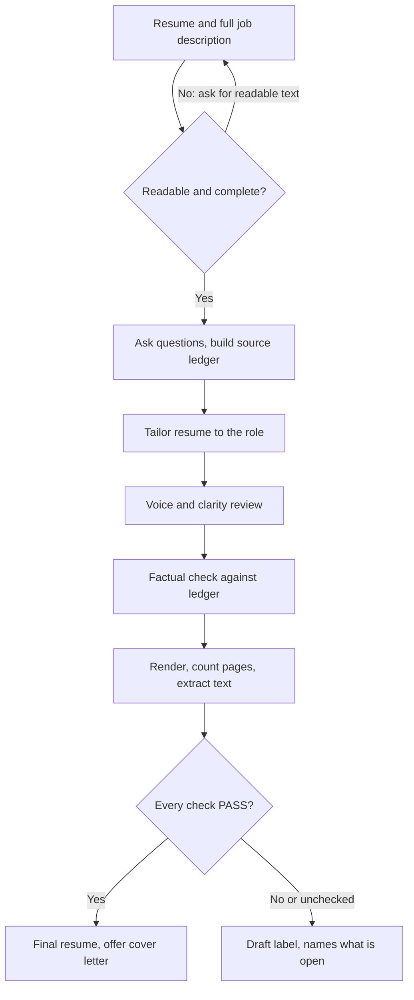

# RoleReady Application

 

[](../../../../README.md#compatibility) [](../../../../README.md#compatibility) [](../../../../README.md#compatibility)

Tailor a truthful resume and cover letter to one job, then review clarity, candidate voice, factual fidelity, and rendered documents.

## When and how to use it

**Use it when**
- You apply for a job and want a resume that fits the posting.
- You need a cover letter that uses real examples from your work.
- You want a review of your draft for clarity and accuracy.

**Try it**

```text
Tailor my resume to this job. Resume: [paste]. Job description: [paste].
Review this cover letter for clarity and for claims my resume does not support: [paste]
```

The agent asks short questions about anything unclear. It then gives a resume of two pages or fewer, with separate notes on evidence gaps and check results (PASS, FAIL or UNVERIFIED). A matching cover letter is offered, not created unasked.

**Skip it when**
- You want skills added that you do not have, or a promise of an interview. The skill keeps to facts you supply and does not submit applications.

## What it looks like

How a resume build moves from your documents to a file you can send:



The source ledger links every resume claim to a line of your original resume or an answer you gave. The check results come back next to the documents, never inside them. Example output, invented data:

```text
Resume checks (target: Operations Analyst, v01)
Readable and complete inputs      PASS
Source facts and role relevance   PASS
Rendered length (2 pages max)     UNVERIFIED  no renderer in this chat
Readability                       PASS
Layout                            UNVERIFIED  no renderer in this chat
Extraction                        UNVERIFIED  no file produced
Filename and target identity      PASS
Overall: UNVERIFIED, so the resume is labelled Draft.
Open question: was the 18% cost cut your project or the team's?
```

## Install

<!-- install:begin -->
Pick your platform. Steps expand below. The [Install section of the collection README](../../../../README.md#install) has the full guide.

<details>
<summary><b>Claude Code (terminal CLI)</b> — recommended</summary>

```bash
claude plugin marketplace add evemcgivern/agent-skills
claude plugin install role-ready-application@evemcgivern-skills
```

The `role-ready-application` plugin holds only this skill. Run it as `/role-ready-application:role-ready-application`. Inside a session, the same thing is `/plugin marketplace add evemcgivern/agent-skills`, then `/plugin install role-ready-application@evemcgivern-skills`.

Update later with `claude plugin marketplace update evemcgivern-skills`, then `claude plugin update role-ready-application@evemcgivern-skills`.

To install only this skill, copy it from a clone of the repo:

```bash
git clone https://github.com/evemcgivern/agent-skills.git && cd agent-skills
scripts/install.sh role-ready-application   # into ~/.claude/skills/role-ready-application
```

Add `--project <repo-path>` for one repository only, or `--force` to replace a copy you already have.

Start a session and ask, for example, "tailor my resume to this job", then paste the job description. Or run `/role-ready-application:role-ready-application`.

Check it worked: `claude plugin list` shows `role-ready-application@evemcgivern-skills` as enabled.

</details>

<details>
<summary><b>Claude Code desktop app</b></summary>

In a local Code session choose **+ → Plugins → Add plugin**, enter `evemcgivern/agent-skills` as the marketplace, then install **role-ready-application**.

Local desktop and CLI sessions share user-scope installs. Cloud Code sessions do not load local plugins; commit this skill folder to your repository's `.claude/skills/role-ready-application/` instead.

Then ask for a resume or cover letter tailored to a job.

</details>

<details>
<summary><b>Codex (CLI, IDE extension, desktop app)</b></summary>

```bash
git clone https://github.com/evemcgivern/agent-skills.git && cd agent-skills
scripts/install.sh --target codex role-ready-application   # into ~/.agents/skills/role-ready-application
```

Add `--project <repo-path>` to install into that repository's `.agents/skills/role-ready-application/` instead. Or copy this folder by hand to `~/.agents/skills/role-ready-application/`, or `.agents/skills/role-ready-application/` in a repository; keep every file in it together. Start a new session and invoke the skill by name. See the [Codex skills docs](https://developers.openai.com/codex/skills-and-plugins).

Restart Codex if the skill does not appear.

</details>

<details>
<summary><b>Other agents: Gemini CLI, Antigravity CLI, Cursor, GitHub Copilot, Windsurf, OpenCode, Cline</b></summary>

These agents load `SKILL.md` folders directly. Copy this whole folder to the place your agent reads:

- Gemini CLI, Antigravity CLI, Cursor, GitHub Copilot, OpenCode: `~/.agents/skills/role-ready-application/` for personal use (`scripts/install.sh --target codex role-ready-application` does this), or `<repo>/.agents/skills/role-ready-application/` for one repository.
- Windsurf: `<repo>/.agents/skills/role-ready-application/`.
- Cline: `<repo>/.cline/skills/role-ready-application/`, `<repo>/.claude/skills/role-ready-application/` or `~/.cline/skills/role-ready-application/`.

</details>

<details>
<summary><b>Claude app (claude.ai)</b></summary>

1. Zip this folder from a clone of the repo (the ZIP must contain the folder itself, with `SKILL.md` inside):
   ```bash
   cd plugins/role-ready-application/skills && zip -r role-ready-application.zip role-ready-application
   ```
2. Turn on code execution under **Settings → Capabilities**.
3. Open **Customize → Skills → + → Create skill → Upload a skill** and upload `role-ready-application.zip`.

On Enterprise, an owner must first enable skills under Organization settings. The same upload works in Claude Cowork. Local `~/.claude/skills/` files do not sync to Claude.ai, so the upload is needed; or commit the folder to a project repository's `.claude/skills/`.

Start a chat and attach your resume and the job description.

To update, delete the skill and upload the new ZIP.

</details>

<details>
<summary><b>ChatGPT</b></summary>

1. Skills in ChatGPT are in beta and available on Business, Enterprise, Edu, Teachers and Healthcare plans, not on personal Free, Plus or Pro plans. On Enterprise and Edu, a workspace admin must first turn skills on and allow skill uploading.
2. Zip this folder (the ZIP must contain the folder itself, with `SKILL.md` inside):
   ```bash
   cd plugins/role-ready-application/skills && zip -r role-ready-application.zip role-ready-application
   ```
3. Open the **Plugins → Skills** tab, choose **+ → Upload from your computer** and upload the ZIP. ChatGPT scans each upload and can mark it Needs Review or Blocked.

The web and desktop apps do not sync skills. Menu labels change, so OpenAI's [Skills in ChatGPT](https://help.openai.com/en/articles/20001066-skills-in-chatgpt) article is the source of truth. ChatGPT runs skills in a remote sandbox with no access to your local files, repo or local shell. On other plans, use Codex, which reads skill folders directly.

In a chat, type `@` to pick the skill, and attach your resume and the job description.

No skill upload on your plan? Open a new chat or a project and paste the contents of [`COPY-PASTE.txt`](COPY-PASTE.txt) as the instructions, then attach your documents. It is the same workflow as one plain-text file.

OpenAI does not list the file types the skill upload accepts, so the ZIP route is untested here.

</details>

<details>
<summary><b>Any other assistant</b></summary>

1. Paste [`COPY-PASTE.txt`](COPY-PASTE.txt) at the start of a chat.
2. Attach your resume and the job description, and ask for a tailored resume or cover letter.

</details>

The skill works only with what you give it in the conversation. It does not need access to email, contacts or connected accounts.

<!-- install:end -->

## Included

- `SKILL.md` and all workflow reference/template files:
- `COPY-PASTE.txt`
- `SKILL.md`
- `references/natural-writing-review.md`
- `references/resume-format.md`
- `references/roles-and-filenames.md`
- `agents/openai.yaml` for ChatGPT/Codex skill-card metadata.
- `VERSION` and `CHANGELOG.md` for this package snapshot.

RoleReady Application portable workflow.
